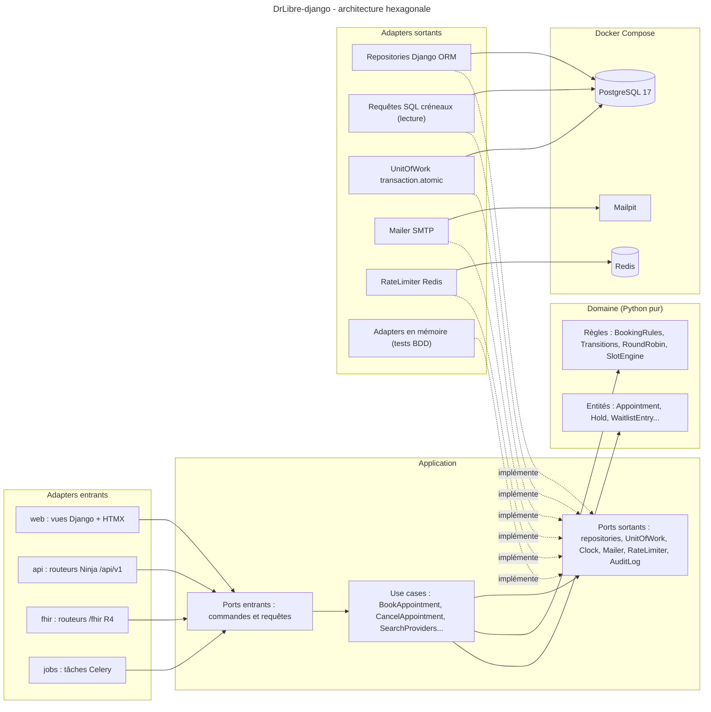

# INSTALL.md - DrLibre-django
Technical vision and installation guide.

## Vision
Hospital appointment scheduling: anyone searches hospitals, providers and specialties, sees the next free slots and books without an account; patients, clinicians and admins each get their own workspace, every write is audited, and every concept is exposed through a FHIR R4 API.

DrLibre-django is a portfolio sandbox built from the functional specification `drlibre-specs.md` (fictitious data, runs on localhost). It is a B2B2C platform: hospitals are the customers, patients are the public, one global admin team runs every hospital. Its differentiator is the back end: a Django modular monolith in hexagonal architecture, driven by BDD on use cases, a FHIR R4 facade over the same use cases, and a p95 < 200 ms target proven by load tests.

## Decisions
| Decision | Choice | Why |
| --- | --- | --- |
| Architecture | Modular monolith, hexagonal (ports and adapters) per bounded context, light CQRS for reads | Back end is the showcase; one deploy unit on localhost; screaming architecture (contexts at the top level); reads bypass the domain to hold p95 < 200 ms |
| Front-end | Django templates (server-rendered) + HTMX 2.0.x, Pico.css; Alpine.js only if a screen needs it | Front is deliberately minimal and dumb: no business logic in templates, presenters build ViewModels; server HTML keeps WCAG 2.2 AA simple |
| Back-end | Python 3.13, Django 6.1, Django Ninja 1.8 for `/api/v1` and `/fhir`, Celery 5.6 + beat | Team is Python/Django; Ninja is Pydantic v2 native; Django 6.x ships built-in CSP; Django's built-in tasks have no production worker or scheduler yet, so Celery runs reminders and expiries |
| FHIR | Own relational domain model + FHIR R4 (4.0.1) facade with hand-written Pydantic v2 schemas | Spec section 15 is a facade; `fhir.resources` 7+ dropped R4 (R5/R4B only) and 6.x is Pydantic v1, incompatible with Ninja |
| Database | PostgreSQL 17 with a transactional `slot` table; Redis 8 for cache, rate limiting and Celery broker | Relational, transactional data (write + audit + notifications in one transaction); precomputed slots make next-availability search a few-ms indexed query |
| Auth | Custom Django auth: email-based User, sessions storing only a token hash, passwordless email code and sign-in link, hashed Bearer tokens for API/FHIR | Spec requires flows no provider covers exactly (10-min hold + code, patient-only 24 h link sessions); 0 EUR budget, localhost only |
| Hosting | Docker Compose on localhost: web, worker, beat, postgres, redis, mailpit | 0 EUR budget; Mailpit catches every email (codes, sign-in links) in a local inbox |
| Ports typing | `typing.Protocol`, adapters inherit the port explicitly, checked by Pyrefly | Structural typing with full signature checks; explicit inheritance keeps "this adapter implements this port" readable |
| Wiring | Composition root in `bootstrap/` | Use cases are wired once and shared by web, API, FHIR and Celery, so every door runs the same rules and audit (spec 15.1); BDD tests wire in-memory fakes in the same place |

### Testing strategy
Test behaviour, not functions: a refactoring that keeps behaviour must break no test. No mocks on owned ports, in-memory fakes instead.

1. **Use cases (BDD)**: Gherkin scenarios with pytest-bdd, run against in-memory fakes. Bulk of the suite.
2. **Complex domain rules as behaviour units**: `SlotEngine` (DST, buffers), round robin ranking, with Hypothesis properties. Never their internal functions.
3. **Presenters**: unit tests of the ViewModels the dumb templates render (time zone named, status not by colour alone). Business decisions such as "can cancel" come from the domain, presenters only map them.
4. **Contract tests**: one suite per port, run against the in-memory fake and the real adapter, so fakes never drift.
5. **Integration**: ORM and SQL adapters on PostgreSQL, mailer on Mailpit, rate limiter on Redis.
6. **FHIR contract**: CapabilityStatement, Bundles, OperationOutcome, status mapping.
7. **E2E**: a few Playwright journeys.
8. **Load**: Locust scenarios on search and booking against the demo seed (10 hospitals, 200 clinicians, 5k patients, 50k appointments, 20 req/s peaks). Results are machine-specific and stated as such.

Mutation testing (mutmut) measures test quality instead of coverage.

## Stack summary
- **Front-end:** Django templates, HTMX 2.0.x (not 4.x, breaking changes), Pico.css, optional Alpine.js.
- **Back-end:** Python 3.13, Django 6.1 (move to 6.2 LTS in April 2027), Django Ninja 1.8, Pydantic v2, Celery 5.6 + beat, structlog (JSON logs with correlation id), pydantic-settings, argon2-cffi.
- **Database:** PostgreSQL 17, Redis 8.
- **Auth:** custom Django auth (password for staff, email code and sign-in link for patients, hashed session and API tokens).
- **Hosting:** Docker Compose on localhost, Mailpit as SMTP sink.
- **Key integrations:** transactional email (Mailpit locally), FHIR R4 4.0.1 API.
- **Tooling:** uv, Ruff (lint and format), Pyrefly 1.x with django-stubs, import-linter (hexagon boundaries in CI), pre-commit, Python Doctor (0-100 health score: security via bandit, complexity via radon, dead code via vulture; pre-commit gate on a minimum score, `--strict` against regressions, and its Claude Code plugin for the `/python-doctor` loop).
- **Django guardrails:** Ruff `DJ` rules, `manage.py check --deploy --fail-level WARNING` on prod-like settings, `makemigrations --check --dry-run`, django-migration-linter (unsafe migrations), django-zeal (N+1 queries fail the tests), django-upgrade (rewrites deprecated APIs), and project-specific Django system checks for our own invariants. django-doctor is not used: unmaintained since 2021.
- **Tests:** pytest, pytest-bdd, pytest-django, Hypothesis, mutmut, Playwright, Locust. Not used on purpose: freezegun (`Clock` port), factory_boy (hand-written test data builders), mocks on owned ports.

## Architecture

Driving adapters (web, API, FHIR, Celery) only call inbound ports; they never import infrastructure. Use cases orchestrate pure-Python entities and rules and reach the outside only through outbound ports; a `UnitOfWork` makes each write, its audit entry and its notifications one transaction. Driven adapters implement those ports with Django ORM, SQL read queries, SMTP and Redis, and in-memory fakes implement the same ports for BDD tests. import-linter enforces these boundaries in CI.

Bounded contexts: `identity`, `organisation`, `scheduling`, `booking`, `waitlist`, `notifications`, `audit`, `search`, `reporting`. Admin CRUD with no business logic (hospitals, rooms, specialties) may use a thinner path, recorded in an ADR.

## Folder structure
```
drlibre-django/
├── src/drlibre/
│   ├── shared_kernel/              # Id, Clock, typed errors (spec section 4 codes), Result, time zones
│   ├── <context>/                  # identity, organisation, scheduling, booking, waitlist,
│   │   │                           #   notifications, audit, search, reporting
│   │   ├── domain/                 # entities, value objects, rules; pure Python, no Django import
│   │   ├── application/
│   │   │   ├── ports/              # inbound (commands, queries) and outbound (repositories, UoW, Mailer...)
│   │   │   └── use_cases/          # one file per business verb: book_appointment.py, cancel_appointment.py...
│   │   └── infrastructure/
│   │       ├── django/             # the context's Django app: models.py, migrations/, apps.py
│   │       ├── repositories.py     # ORM adapters and ORM <-> domain mappers
│   │       └── queries.py          # SQL read adapters (light CQRS)
│   ├── interfaces/                 # driving adapters
│   │   ├── web/                    # Django views, presenters, templates, HTMX partials
│   │   ├── api/                    # Django Ninja routers /api/v1
│   │   ├── fhir/                   # /fhir R4: Pydantic v2 schemas, FHIR <-> command mappers, CapabilityStatement
│   │   └── jobs/                   # Celery tasks (reminders, expiries)
│   └── bootstrap/                  # composition root: wires ports to adapters
├── config/                         # Django settings, urls, celery.py, middleware (correlation id, CSP)
├── tests/
│   ├── features/                   # Gherkin .feature files per context
│   ├── use_cases/                  # pytest-bdd steps on in-memory fakes
│   ├── rules/                      # complex domain rules as behaviour units (Hypothesis)
│   ├── presenters/                 # ViewModel tests
│   ├── contracts/                  # same suite per port: fake vs real adapter
│   ├── integration/                # ORM/SQL adapters on PostgreSQL, Mailpit, Redis
│   ├── fhir/                       # FHIR R4 contract tests
│   └── e2e/                        # a few Playwright journeys
├── loadtests/                      # locustfile.py
├── scripts/                        # idempotent demo seed
├── docker/                         # Dockerfile, entrypoint
├── docker-compose.yml              # web, worker, beat, postgres, redis, mailpit
├── pyproject.toml                  # uv, Ruff, Pyrefly, import-linter, pytest config
├── manage.py
└── aidd_docs/INSTALL.md
```

## Install steps
Manual install - the framework does not yet scaffold these automatically.

1. Install Docker (Engine or Desktop) and uv, then let uv provide Python 3.13.
2. Initialise the project with uv and add the dependencies of the stack summary, pinning Celery 5.6 and HTMX 2.0.x.
3. Create `.env` from a committed `.env.example`: Django secret key, `DATABASE_URL`, `REDIS_URL`, SMTP host `mailpit:1025`, hospital default time zone.
4. Start the stack with Docker Compose (web, worker, beat, postgres, redis, mailpit).
5. Apply the migrations and run the idempotent demo seed (one demo sign-in per role).
6. Install the pre-commit hooks (Ruff, Pyrefly, import-linter, Python Doctor with a minimum score) and check the app on `localhost:8000` and the Mailpit inbox on `localhost:8025`.

## Audit summary
Results of the multi-agent audit run during action 03:

| Candidate | Verdict | Notes |
| --- | --- | --- |
| A. Django hypermedia (picked) | ⚠️ | Mature stack, 0 EUR realistic; `fhir.resources` lacks R4 (mitigated by hand-written schemas); pin HTMX 2.0.x and Celery 5.6; p95 < 200 ms needs the precomputed slot table |
| B. Django API + React SPA | ⚠️ | Stable parts, but Ninja skips CSRF on anonymous POSTs (hold, code, sign-in link), second TypeScript codebase, WCAG fully on the SPA |
| C. Django + FastAPI read service | ⚠️ | Pickled session sharing; materialised view refresh breaks "shown = bookable"; a transactional slot table in Django gives the same speed without a second service |
