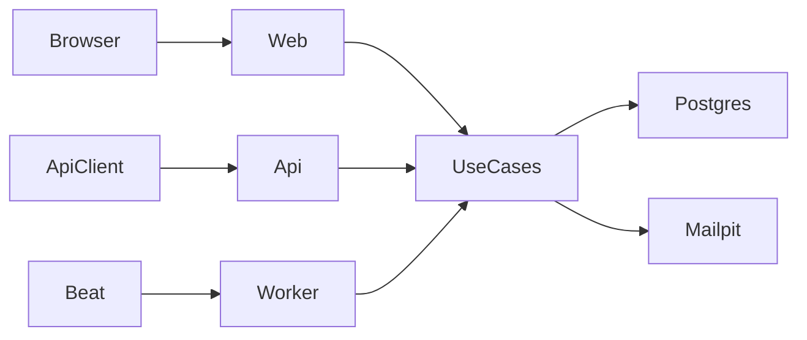

# Architecture
## Stack
- Python and Django: the project showcases a Django back end.
- Django Ninja serves the application API and the FHIR API, Pydantic native.
- PostgreSQL holds all data; Redis serves cache, rate limiting and the Celery broker.
- Celery with beat runs emails, hold expiry (every 60 s), reminders and the daily slot horizon (00:15 local, `CELERY_TIMEZONE`); Django's built-in tasks lack a production worker and scheduler.
- Django templates with HTMX and Pico.css; the front stays minimal.
- Libraries: Pydantic validates every boundary; structlog writes JSON logs; pydantic-settings loads config; no freezegun, no factory_boy, no mock library.
- Pinned versions and why: `aidd_docs/INSTALL.md`.

## Config
- Environment variables come from a `.env` file read by pydantic-settings; a new variable is declared in the settings class and the committed example file.
- `PUBLIC_BASE_URL` (default `http://localhost:8000`) builds the absolute links in emails; `NETWORK_HOURLY_LIMIT` (default 20) caps holds, codes and link requests per `REMOTE_ADDR` and kind, raise it for load runs.

## Decisions
- Hexagonal architecture per bounded context, so the domain stays pure Python and testable without Django.
- `booking` owns appointments, holds, codes, booking rules, round robin and the placement shared by every booking path; `search` is a read side whose SQL adapter reads the organisation, identity, scheduling and booking tables directly.
- Light CQRS: commands go through the domain, search, slots and reporting read through SQL query ports to hold p95 under 200 ms.
- FHIR R4 is a facade with hand-written Pydantic schemas, because the fhir.resources library dropped R4.
- One composition root wires ports to adapters, so web, API, FHIR and Celery run the same use cases.
- Ports are `typing.Protocol` classes that adapters inherit explicitly, checked by Pyrefly.
- Auth is custom: hashed session tokens, email code and sign-in link, hashed bearer tokens.

## Constraints
- p95 under 200 ms, search included, proven by load tests.
- Zero budget, localhost only through Docker Compose.
- WCAG 2.2 AA; templates hold no business logic, presenters build ViewModels.

## Dependencies
- Domain imports only the shared kernel and the standard library.
- Application imports the domain and declares ports.
- Infrastructure implements application ports.
- Interfaces call inbound ports only, wired by the composition root.
- Contexts reach each other only through ports.
- import-linter enforces these directions.

## Gotchas
- Django Ninja checks CSRF only inside cookie auth, so anonymous POSTs need an explicit check.
- The slot table is updated in the same transaction as each booking.
- `scheduling_slot` holds free slots per clinician and type, today to today + 90 days; `RefreshSlots` rebuilds a clinician's rows inside the unit of work of each rule or time-off write, and of each appointment type save or clinician profile attach, edit, delete through organisation's `SlotRefresh` port.
- A clinician's overlap and duplicate checks are serialised by `select_for_update` on their profile, inside the unit of work of the write.
- Past slots and inactive clinicians are filtered at read time; the daily job only extends the horizon.
- Hold expiry is checked in the slot query, never left to a scheduled job.
- Django stores session keys raw; the session store must keep only a hash.
- Own session cookie `drlibre_session` (HttpOnly, SameSite=Lax, Secure with `HTTPS_ONLY`); `django.contrib.sessions` and `django.contrib.auth` stay uninstalled, Django's hashers work without them.
- `SameOriginMiddleware` refuses unsafe methods from another origin, API included; CSRF stays on for web forms.
- Holds never touch `scheduling_slot`: `FindFreeSlots` and the search SQL drop a slot overlapping an open hold (`expires_at > now`), so an expired hold frees it without a job; a booking rebuilds the clinician's slots in its unit of work.
- Appointments reach other contexts through ports backed by booking: scheduling's `ClinicianAppointments` (`BookingClinicianAppointments`), identity's `UpcomingAppointments`, organisation's `ScheduleDependents` (`ScheduleAndBookingDependents`) with `RoomUsage`; the null adapters are gone; dependents are checked inside the unit of work of the delete.
- Wiring order in `real_adapters()`: booking queries, then scheduling adapters reading them, then booking use cases using scheduling's ports (`IsSlotFree`, `FreeCliniciansAt`, `RefreshSlots`) and organisation's `RecordRoundRobinAssignment`.
- A hold's code attempts are counted under `select_for_update` on the code row (`VerificationCodes.for_hold_locked`) inside the unit of work of each check, so concurrent wrong codes never exceed 5 attempts.
- `booking/infrastructure/schedule_locks.py`, like scheduling's E2 `lock_profile`, locks other contexts' rows (clinician profile, user) through their ORM models: the accepted exception to contexts reaching each other only through ports.
- A hold first takes `lock_email` (`pg_advisory_xact_lock` on a 64-bit hash of the lower-cased email, nothing stored) before reading the email's open hold, so an email never has two open holds; the global order is email, clinician(s), patient, rooms.
- A booking locks in one order, clinician(s), then patient, then the department's active rooms (`lock_rooms`, before `busy_rooms`), so two clinicians of one department never get the same room and writers never deadlock; a first-available booking locks every candidate clinician at once in pk order (`lock_clinicians`), then ranks and picks under those locks.
- Emails are queued on commit by `CeleryEmailOutbox` (`send_task`, redacted reprs keep codes and link tokens out of worker logs; the request log keeps `path` only).
- Rate-limit keys use `settings.RATE_LIMIT_PREFIX`; a code is stored as HMAC-SHA256 keyed by `SECRET_KEY`, a sign-in link token as sha256.
- Web views catch `invalid_input`, `has_dependents` and `forbidden` to re-render their form or delete confirmation; other refusals become error pages through `DomainErrorPagesMiddleware` (rule 6-domain-errors).
- The audit log is append-only in PostgreSQL: triggers refuse every `UPDATE`, `DELETE` and `TRUNCATE` on `audit_auditentryrecord` (migration `audit.0002`), ORM bulk calls and raw SQL included; the test database disables only the `TRUNCATE` trigger in `tests/conftest.py` so transactional tests can flush.
- Gunicorn serves `static/` through `django.views.static.serve`; localhost has no static server.

## Flow

