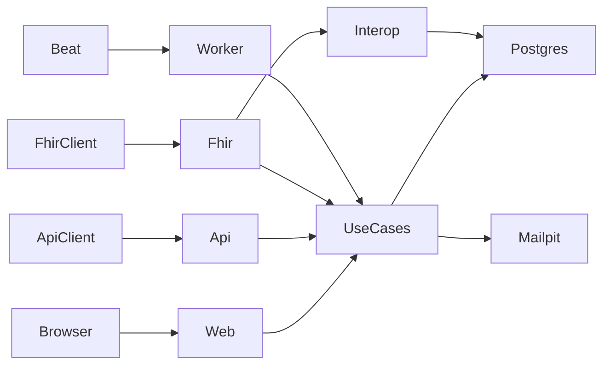

# Architecture
## Stack
- Python and Django: the project showcases a Django back end.
- Django Ninja serves the application API and the FHIR API, Pydantic native.
- PostgreSQL holds all data; Redis serves cache, rate limiting and the Celery broker.
- Celery with beat runs emails, hold expiry and waitlist expiry (every 60 s), reminders (every 15 min) and the daily slot horizon (00:15 local, `CELERY_TIMEZONE`); Django's built-in tasks lack a production worker and scheduler.
- Django templates with HTMX and Pico.css; the front stays minimal.
- Libraries: Pydantic validates every boundary; structlog writes JSON logs; pydantic-settings loads config; no freezegun, no factory_boy, no mock library.
- Pinned versions and why: `aidd_docs/INSTALL.md`.

## Config
- Environment variables come from a `.env` file read by pydantic-settings; a new variable is declared in the settings class and the committed example file.
- `PUBLIC_BASE_URL` (default `http://localhost:8000`) builds the absolute links in emails; `NETWORK_HOURLY_LIMIT` (default 20) caps holds, codes and link requests per `REMOTE_ADDR` and kind, raise it for load runs.

## Decisions
- Hexagonal architecture per bounded context, so the domain stays pure Python and testable without Django.
- `booking` owns appointments, holds, codes, booking rules, round robin, the waitlist and the placement shared by every booking path; `search` is a read side whose SQL adapter reads the organisation, identity, scheduling and booking tables directly.
- Light CQRS: commands go through the domain, search, slots and reporting read through SQL query ports to hold p95 under 200 ms.
- FHIR R4 is a facade with hand-written Pydantic schemas, because the fhir.resources library dropped R4.
- One composition root wires ports to adapters, so web, API, FHIR and Celery run the same use cases.
- Ports are `typing.Protocol` classes that adapters inherit explicitly, checked by Pyrefly.
- Auth is custom: hashed session tokens, email code and sign-in link, hashed bearer tokens.
- FHIR R4 facade: a second `NinjaAPI` at `/fhir` (`interfaces/fhir/`), `application/fhir+json`, every `DomainError` an `OperationOutcome` with `ErrorCode.http_status`.
- One registry (`interfaces/fhir/registry.py`) declares each resource's interactions, search parameters, `_include` and `_sort`; it serves `/fhir/metadata`, refuses undeclared parameters (`invalid_input`) and answers 405 `not-supported` on undeclared interactions.
- `interop` is a read context: SQL reads of organisation, identity, scheduling, booking, notifications and audit tables, scoped in the SQL by `Reader` (anonymous, patient, clinician, admin), each row with its version; plus `ConditionalWrites` for `If-Match`. A time-off reason reaches only the admin and its own clinician (`Reader.reads_reasons_of`); `UpdateProfile` refuses an actor other than the user (`forbidden`), admins edit through `SaveUser`.
- FHIR writes call the screens' use cases; reference writes check `require_admin` at the FHIR door, as the console's `require_role`.
- A specialty is both a `CodeSystem` and a `ValueSet` (one included concept) sharing its id, as a hospital is an `Organization` and a `Location`; both write through `SaveSpecialty`/`DeleteSpecialty`.

## Constraints
- p95 under 200 ms, search included, proven by load tests.
- Zero budget, localhost only through Docker Compose.
- WCAG 2.2 AA; templates hold no business logic, presenters build ViewModels.

## Dependencies
- Domain imports only the shared kernel and the standard library.
- Application imports the domain and declares ports.
- Infrastructure implements application ports.
- Interfaces call inbound ports only, wired by the composition root.
- Contexts reach each other only through ports.
- import-linter enforces these directions.

## Gotchas
- Django Ninja checks CSRF only inside cookie auth, so anonymous POSTs need an explicit check.
- A window clipped by a policy (now + lead time, horizon) can end empty or inverted: return no slots when its start reaches its end, and test that edge (late Sunday week).
- The slot table is updated in the same transaction as each booking.
- `scheduling_slot` holds free slots per clinician and type, today to today + 90 days; `RefreshSlots` rebuilds a clinician's rows inside the unit of work of each rule or time-off write, and of each appointment type save or clinician profile attach, edit, delete through organisation's `SlotRefresh` port.
- A clinician's overlap and duplicate checks are serialised by `select_for_update` on their profile, inside the unit of work of the write.
- Past slots and inactive clinicians are filtered at read time; the daily job only extends the horizon.
- Hold expiry is checked in the slot query, never left to a scheduled job.
- Django stores session keys raw; the session store must keep only a hash.
- Own session cookie `drlibre_session` (HttpOnly, SameSite=Lax, Secure with `HTTPS_ONLY`); `django.contrib.sessions` and `django.contrib.auth` stay uninstalled, Django's hashers work without them.
- `SameOriginMiddleware` refuses unsafe methods from another origin, API included; CSRF stays on for web forms.
- Holds never touch `scheduling_slot`: `FindFreeSlots` and the search SQL drop a slot overlapping an open hold (`expires_at > now`), so an expired hold frees it without a job; a booking rebuilds the clinician's slots in its unit of work.
- Rooms never touch `scheduling_slot` either (§6.2): for a `needs_room` type, `FindFreeSlots` (through `RoomBookings`, backed by booking's `AppointmentQueries.room_periods`) and the search SQL (`EXISTS` active room `NOT EXISTS` overlapping active appointment, on `appointment_room_start`) drop a slot when every active room of the type's department is taken, as `Placement.room` would refuse it; reschedule ignores its own appointment; `IsSlotFree` and `FreeCliniciansAt` stay room-blind so booking still answers `no_room_available`.
- Appointments reach other contexts through ports backed by booking: scheduling's `ClinicianAppointments` (`BookingClinicianAppointments`), identity's `UpcomingAppointments`, organisation's `ScheduleDependents` (`ScheduleAndBookingDependents`) with `RoomUsage`; the null adapters are gone; dependents are checked inside the unit of work of the delete.
- Wiring order in `real_adapters()`: booking queries, then scheduling adapters reading them, then booking use cases using scheduling's ports (`IsSlotFree`, `FreeCliniciansAt`, `RefreshSlots`) and organisation's `RecordRoundRobinAssignment`.
- A hold's code attempts are counted under `select_for_update` on the code row (`VerificationCodes.for_hold_locked`) inside the unit of work of each check, so concurrent wrong codes never exceed 5 attempts.
- `booking/infrastructure/schedule_locks.py`, like scheduling's E2 `lock_profile`, locks other contexts' rows (clinician profile, user) through their ORM models: the accepted exception to contexts reaching each other only through ports.
- A hold first takes `lock_email` (`pg_advisory_xact_lock` on a 64-bit hash of the lower-cased email, nothing stored) before reading the email's open hold, so an email never has two open holds; the global order is email, clinician(s), patient, waitlist entries, rooms.
- A booking locks in one order, clinician(s), then patient, then the department's active rooms (`lock_rooms`, before `busy_rooms`), so two clinicians of one department never get the same room and writers never deadlock; a first-available booking locks every candidate clinician at once in pk order (`lock_clinicians`), then ranks and picks under those locks.
- Emails are queued on commit by `CeleryEmailOutbox` (`send_task`, redacted reprs keep codes and link tokens out of worker logs; the request log keeps `path` only).
- Rate-limit keys use `settings.RATE_LIMIT_PREFIX`; a code is stored as HMAC-SHA256 keyed by `SECRET_KEY`, a sign-in link token as sha256.
- Web views catch `invalid_input`, `has_dependents` and `forbidden` to re-render their form or delete confirmation, booking, portal and waitlist pages also `rule_violation`, `invalid_transition`, `conflict`, `no_clinician_available` and `no_room_available` inline, waitlist pages also `not_found` on a join or a manual offer; other refusals become error pages through `DomainErrorPagesMiddleware` (rule 6-domain-errors).
- Appointment statuses: `BOOKED`, `CHECKED_IN`, `COMPLETED`, `CANCELLED`, `NO_SHOW`; `CONFIRMED` is removed, migrated to `BOOKED`.
- In-app notifications live in `notifications` (`Notify`, `ListNotifications`, `MarkNotificationRead`, `CountUnread`); booking's `BookingNotices` writes the row in the unit of work and queues the email on commit; « RDV réservé » is in-app only, the E3 confirmation stays the booking email; `Notify` takes an optional appointment, « Créneau proposé » links none (the freed one is another patient's).
- Waitlist: `CancelAppointmentUseCase`, patient or clinician cancelling, offers the freed slot in its unit of work, after the slot refresh, to the oldest matching `WAITING` entry of a patient other than the appointment's (`Waitlist.candidates_locked` locks the set in id order, the oldest is picked from that re-read); the offer reserves nothing.
- Partial unique index `waitlist_one_offer_per_appointment` (`offered_appointment` where `OFFERED`): its `IntegrityError` becomes `conflict`.
- Accept locks clinician, patient, then the entry, re-reads it and runs `Placement.place(announce=False)` in the same unit of work; a `conflict` puts the entry back to `WAITING` and commits, then is raised; `rule_violation` writes nothing.
- `ExpireWaitlist` (beat `expire-waitlist`, 60 s) expires `WAITING` entries past their window and frees `OFFERED` ones whose slot started, one audit entry each, actor empty.
- One reminder per appointment: a partial unique index on `APPOINTMENT_REMINDER`, inserted in a savepoint; its `IntegrityError` means already sent, so no email.
- PostgreSQL guards behind the locks: `btree_gist` exclusions `appointment_clinician_no_overlap` and `appointment_patient_no_overlap` on active appointments, checks on end after start, known status, cancellation fields; an exclusion hit becomes `conflict`, never a 500.
- Cancel and reschedule take the booking lock order and re-read the appointment under the locks; reschedule ignores its own appointment: `IsSlotFree`, `FindFreeSlots` and `FindFreeWeek` take `ignoring_appointment` and recompute that clinician's slots with `SlotEngine`, `conflicting_resources` and `busy_rooms` take `excluding`.
- The audit log is append-only in PostgreSQL: triggers refuse every `UPDATE`, `DELETE` and `TRUNCATE` on `audit_auditentryrecord` (migration `audit.0002`), ORM bulk calls and raw SQL included; the test database disables only the `TRUNCATE` trigger in `tests/conftest.py` so transactional tests can flush.
- Spec §3: every ORM record but the audit inherits `persistence.records.TrackedRecord` (`created_at`, `updated_at` by `auto_now` and its `QuerySet.update`, `created_by` from the `SessionMiddleware` contextvar, null for visitors and jobs); columns the domain already fills keep their `Clock` values.
- Clinician guard: `BookingDirectory.clinician_of_user` gives the caller's profile; `own_clinician_appointment` answers `not_found` for an unknown id, `forbidden` for another clinician's (web shows « Not your appointment »).
- Status changes (`CheckInAppointment`, `CompleteAppointment`, `MarkNoShow`) share `StatusChange`: lock clinician then patient, re-read, transition in `Appointment`, audit `{from, to}`, no notice; `NO_SHOW` rebuilds the clinician's slots.
- Staff are bound only by availability and conflicts: cancel and reschedule pick the guard from the actor (clinician: no 24 h rule), `BookForPatient` places with `for_patient=False`, source `STAFF`; `FindFreeWeek(for_patient=False)` drops the 120-min clip.
- Clinical notes: nullable `clinical_notes` on `AppointmentRecord`, written only by `WriteClinicalNotes` (≤ 5000), audited as `{fields: ("clinical_notes",)}`; never in API rows, emails or the patient portal.
- Workspace reads go through booking's SQL `ClinicianAgenda` (`SqlClinicianAgenda`); the appointment history reads audit's `AuditQueries.entries_for` through `AuditAppointmentHistory`, indexed on `(entity_type, entity_id, at)` (`audit.0003`).
- Actor scope: `actor_scope` maps a profile to clinician, `Staff.is_admin` to admin, else patient; `scoped_appointment` lets an admin read any appointment (`not_found` if absent), others keep their guards; admins follow staff rules (no 24 h, `for_patient=False`), clinical notes stay `forbidden` to them.
- Admin `BookForPatient` requires a clinician; the named room must be active in the type's department (`not_found`), then free (`conflict`); source `STAFF`.
- `reporting` is a read-only context: `ActivityQueries` in SQL plus pure `available_minutes`, minutes in each clinician's hospital zone; utilisation counts active clinicians' appointments only, RDV counts every clinician's; ratios with a zero denominator show « n/a »; bar widths are `.bar-N` classes, the CSP forbids inline styles.
- The audit journal is read through audit's `ViewAuditJournal` (admin only); its `JournalActors` port (`IdentityJournalActors`) resolves the actor filter's email and the page's actor emails through identity; an unknown email matches no entry.
- `ExportAppointments` (admin only) writes one `booking.appointments_exported` audit entry `{count}`; `csv_cell` prefixes `'` before `= + - @ \t \r`.
- The audit log is read through `AuditQueries.page` (newest first, total) and `entity_types()`, called by `ViewAuditJournal`, whose `AuditJournal` carries the zone (`settings.TIME_ZONE`) its dates are read and shown in, named.
- Index `appointment_start` on `start` (`booking.0005`) serves the admin list, export and dashboard across hospitals.
- API admin `GET /appointments` takes the list filters, `from`/`to` keep the date of the aware datetime; `POST /jobs/reminders` runs `RunReminders` synchronously and returns `{count}`.
- The admin file history shows clinician actions as « Personnel ».
- Bearer tokens: identity `ApiTokenRecord` (sha256 hash, user, label, expiry), issued and revoked by `manage.py api_token <email> [--days N] [--revoke]`, audited; `AuthenticateToken` refuses an unknown, expired or inactive user's token, so a deactivated user loses access at once; `must_change_password` gets 403 `forbidden`.
- A bearer authenticates only under `/fhir/` and `/api/` (`interfaces/paths.py`), never a web page; under `/fhir/` only the bearer counts, the session cookie is ignored, so `/fhir/` is exempt from `SameOriginMiddleware` and `DomainErrorPagesMiddleware`.
- `If-Match` runs in `ConditionalWrites.run` under the write's own lock order, then compares the version: appointment profile, patient, row; `Schedule` profile, rule; `PractitionerRole` profile; `Patient`, `Practitioner`, `Communication` the user row; a reference record its own row (organisation use cases and `SaveUser` take no row lock); 412 `conflict` when stale.
- `interop/infrastructure/conditional_writes.py` locks other contexts' rows through their ORM models: the second accepted exception beside booking's `schedule_locks`.
- `ConditionalWrites.run` runs the write in its outer transaction, so any refusal rolls back every use case it ran (`notAvailable`); it locks profile and user rows `FOR UPDATE`, as the use cases re-lock them (no lock upgrade), other rows `FOR NO KEY UPDATE`, so foreign-key inserts (bookings of a locked type) don't wait; the waitlist accept's commit-then-raise does not go through it.
- `Slot` ids are lower-case unpadded base32 of (profile, type, start), stable and decodable; scheduling's `FindSlotStates` searches them (`free` from `scheduling_slot`, other statuses for staff only), `ReadSlotState` reads one by id.
- An accepted waitlist entry and its appointment share one id: `Appointment/<entry>` goes from `proposed` to `booked`; `AppointmentResponse` is a `BOOKED` entry.
- `SqlInteropAppointmentQueries` takes the `Clock` so an expired hold is never served as `pending`.
- `Communication` and `AuditEvent` are read by interop SQL; only the admin reads `AuditEvent`.
- Gunicorn serves `static/` through `django.views.static.serve`; localhost has no static server.

## Flow

