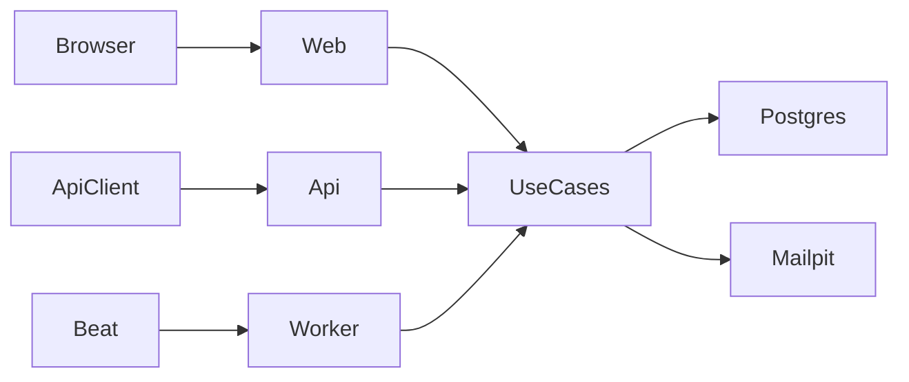

# Architecture
## Stack
- Python and Django: the project showcases a Django back end.
- Django Ninja serves the application API and the FHIR API, Pydantic native.
- PostgreSQL holds all data; Redis serves cache, rate limiting and the Celery broker.
- Celery with beat runs reminders, expiries and the daily slot horizon (00:15 local, `CELERY_TIMEZONE`); Django's built-in tasks lack a production worker and scheduler.
- Django templates with HTMX and Pico.css; the front stays minimal.
- Libraries: Pydantic validates every boundary; structlog writes JSON logs; pydantic-settings loads config; no freezegun, no factory_boy, no mock library.
- Pinned versions and why: `aidd_docs/INSTALL.md`.

## Config
- Environment variables come from a `.env` file read by pydantic-settings; a new variable is declared in the settings class and the committed example file.

## Decisions
- Hexagonal architecture per bounded context, so the domain stays pure Python and testable without Django.
- Light CQRS: commands go through the domain, search, slots and reporting read through SQL query ports to hold p95 under 200 ms.
- FHIR R4 is a facade with hand-written Pydantic schemas, because the fhir.resources library dropped R4.
- One composition root wires ports to adapters, so web, API, FHIR and Celery run the same use cases.
- Ports are `typing.Protocol` classes that adapters inherit explicitly, checked by Pyrefly.
- Auth is custom: hashed session tokens, email code and sign-in link, hashed bearer tokens.

## Constraints
- p95 under 200 ms, search included, proven by load tests.
- Zero budget, localhost only through Docker Compose.
- WCAG 2.2 AA; templates hold no business logic, presenters build ViewModels.

## Dependencies
- Domain imports only the shared kernel and the standard library.
- Application imports the domain and declares ports.
- Infrastructure implements application ports.
- Interfaces call inbound ports only, wired by the composition root.
- Contexts reach each other only through ports.
- import-linter enforces these directions.

## Gotchas
- Django Ninja checks CSRF only inside cookie auth, so anonymous POSTs need an explicit check.
- The slot table is updated in the same transaction as each booking or hold.
- `scheduling_slot` holds free slots per clinician and type, today to today + 90 days; `RefreshSlots` rebuilds a clinician's rows inside the unit of work of each rule or time-off write, and of each appointment type save or clinician profile attach, edit, delete through organisation's `SlotRefresh` port.
- A clinician's overlap and duplicate checks are serialised by `select_for_update` on their profile, inside the unit of work of the write.
- Past slots and inactive clinicians are filtered at read time; the daily job only extends the horizon.
- Hold expiry is checked in the slot query, never left to a scheduled job.
- Django stores session keys raw; the session store must keep only a hash.
- Own session cookie `drlibre_session` (HttpOnly, SameSite=Lax, Secure with `HTTPS_ONLY`); `django.contrib.sessions` and `django.contrib.auth` stay uninstalled, Django's hashers work without them.
- `SameOriginMiddleware` refuses unsafe methods from another origin, API included; CSRF stays on for web forms.
- Organisation reads rules using a room through scheduling's `RoomUsage` port; appointments, not modelled yet, are read through null adapters that E3 replaces (`NoAppointmentsYet` for scheduling's `ActiveAppointments`, empty appointment dependents in `SchedulingScheduleDependents`); dependents are checked inside the unit of work of the delete.
- Web views catch `invalid_input`, `has_dependents` and `forbidden` to re-render their form or delete confirmation; other refusals become error pages through `DomainErrorPagesMiddleware` (rule 6-domain-errors).
- Gunicorn serves `static/` through `django.views.static.serve`; localhost has no static server.

## Flow

