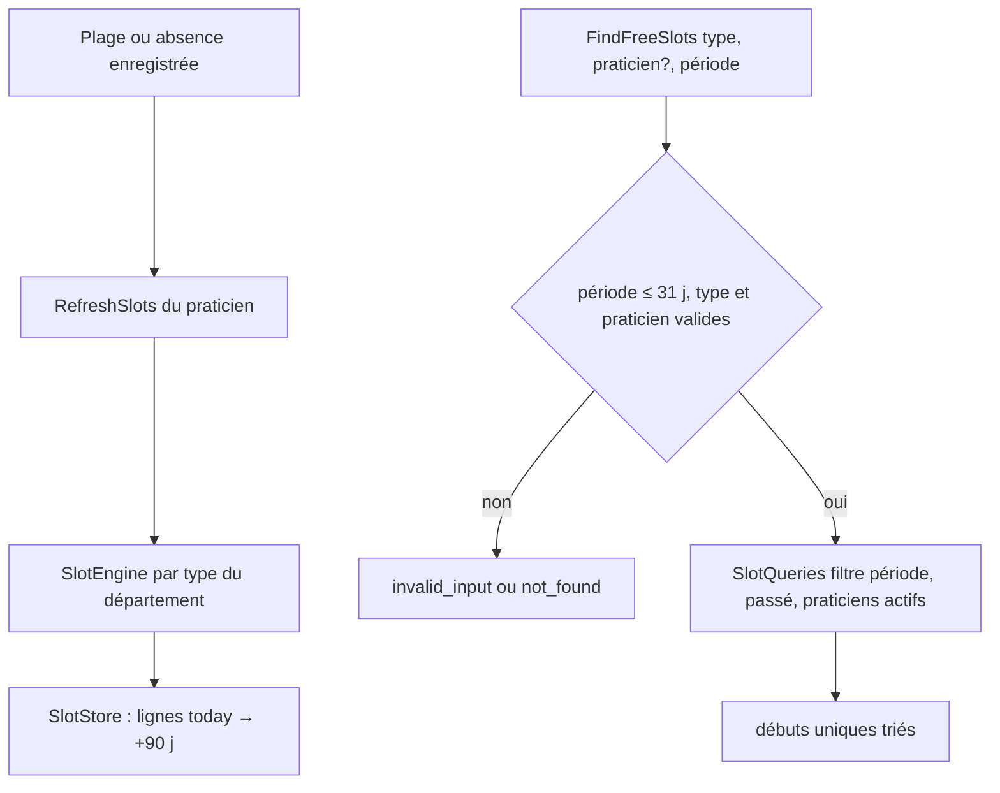

# Instruction: Moteur de créneaux et lecture des créneaux sur fakes
## Architecture projection
> Tree of the final files. ✅ create · ✏️ modify · ❌ delete

```txt
.
├── src/drlibre/scheduling/
│   ├── __init__.py                              ✅
│   ├── domain/
│   │   ├── availability_rule.py                 ✅  weekday 0 Sunday–6 Saturday, HH:MM start < end, step 5–240, optional room, valid from/to
│   │   ├── time_off.py                          ✅  start < end, reason ≤ 200 chars
│   │   ├── slot.py                              ✅  Slot(start, end), aware UTC datetimes
│   │   └── slot_engine.py                       ✅  SlotEngine.free_slots(rules, time_off, busy, duration, buffer, tz, range): §5.1 steps 1–4
│   └── application/
│       ├── ports/inbound.py                     ✅  FindFreeSlots, RefreshSlots
│       ├── ports/outbound.py                    ✅  AvailabilityRules, TimeOffs, ActiveAppointments, SlotStore, SlotQueries, SchedulingDirectory
│       └── use_cases/
│           ├── find_free_slots.py               ✅  31-day cap, not_found checks, union of active clinicians, drops past starts
│           └── refresh_slots.py                 ✅  rebuilds one clinician's rows for every type of its department, today → +90 days
└── tests/
    ├── features/scheduling/
    │   ├── les_plages_du_praticien_donnent_ses_creneaux_libres.feature           ✅
    │   ├── les_absences_et_les_rdv_actifs_retirent_des_creneaux.feature          ✅
    │   └── les_creneaux_d_un_departement_reunissent_ceux_de_ses_praticiens.feature ✅
    ├── use_cases/scheduling/{__init__,test_slots}.py ✅  pytest-bdd steps
    ├── properties/test_slot_engine.py           ✅  Hypothesis: DST, step, buffer, uniqueness, order, bounds
    ├── fakes/scheduling.py                      ✅  InMemoryAvailabilityRules, InMemoryTimeOffs, InMemoryActiveAppointments, InMemorySlotStore (also SlotQueries), FixedSchedulingDirectory
    ├── fakes/world.py                           ✏️  wires the scheduling fakes
    └── builders_scheduling.py                   ✅  rule, time off, appointment builders
```

## User Journey


## Tasks to do
### `1)` Domain
> Pure Python value objects and the `SlotEngine` behaviour unit.

1. Frozen dataclasses per `2-python-value-objects`; validation raises `DomainError(INVALID_INPUT)` with field messages.
2. `SlotEngine`: for each local day of the range, rules of that weekday valid that day; starts from rule start by step while start + duration ≤ rule end, built in the hospital `ZoneInfo` then converted to UTC; drop slots outside the range, overlapping time off, or overlapping busy intervals extended by the type buffer; unique, sorted.
3. The engine never reads the clock; the past is dropped at read time.

### `2)` Ports and use cases
> `FindFreeSlots` reads only the store; `RefreshSlots` is the single writer of the store.

1. `SchedulingDirectory` port: clinician (department, hospital time zone, active), active clinicians of a department, appointment type (department, duration, buffer, active).
2. `RefreshSlots.execute(clinician_id)` runs inside the caller's unit of work; uses `Clock` for today.
3. `FindFreeSlots.execute(type_id, clinician_id | None, start, end)`: range > 31 days → `invalid_input`; unknown/inactive type, clinician unknown/inactive/other department → `not_found`; union over active clinicians when none named, one entry per start.

### `3)` Tests
> Scenario names are the Stories' Acceptance bullets (rule `5-acceptance-test-names`).

1. Three feature files, one per Story above; `GET /slots` bullets proven at use-case level here, the HTTP `unauthenticated` bullet in phase 4.
2. Active appointments injected through `InMemoryActiveAppointments`; `CANCELLED` and `NO_SHOW` never returned by the port contract.
3. Hypothesis properties on `SlotEngine` only, including the 2026-03-29 and 2026-10-25 Europe/Paris weeks: a 09:00–12:00 rule yields a first slot at 09:00 local.

## Test acceptance criteria
| Task | Acceptance criteria |
| --- | --- |
| 1 | A 09:00–12:00 rule with step 15 and a 30-minute type gives 09:00 … 11:30 local, the same on DST weeks |
| 1 | A slot touching time off or an active appointment + buffer is absent; a slot ending exactly at the buffered end is present |
| 2 | A 32-day range is `invalid_input`; an inactive clinician contributes nothing to the department union |
| 2 | Past starts are never returned even though the store holds them for today |
| 3 | `uv run pytest tests/use_cases/scheduling tests/properties -q` green; every Acceptance bullet of the 3 Stories names a scenario |
