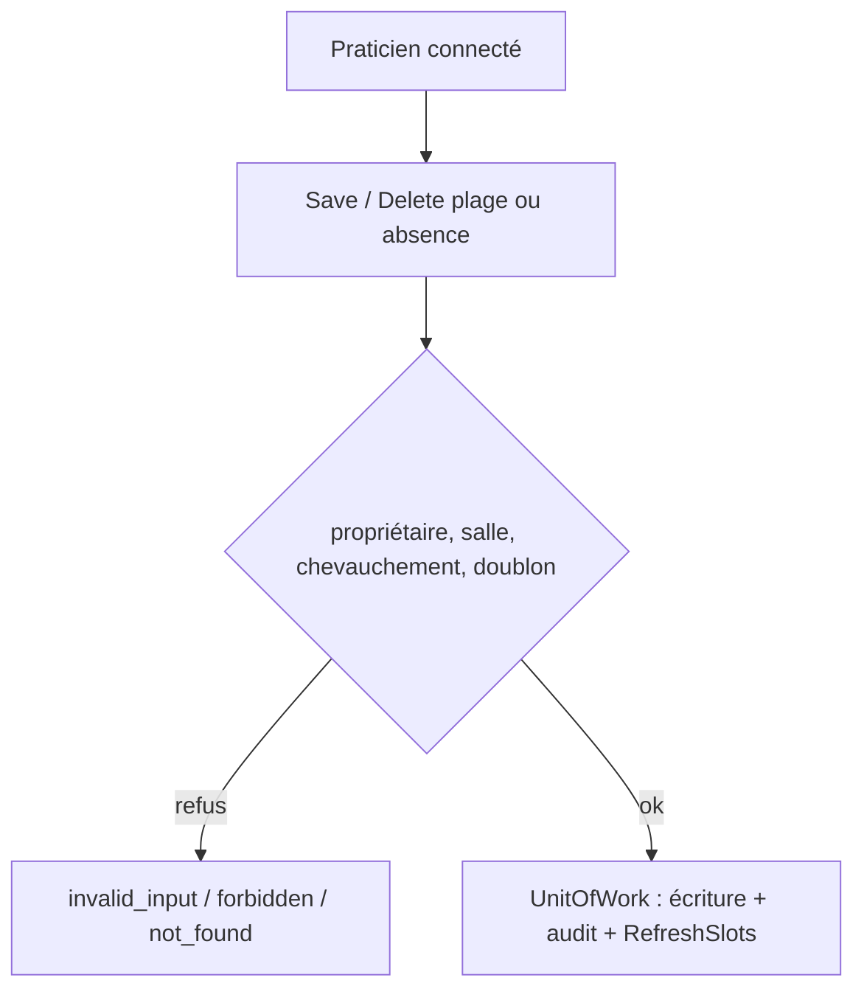

# Instruction: Plages et absences : écriture, audit, persistance
## Architecture projection
> Tree of the final files. ✅ create · ✏️ modify · ❌ delete

```txt
.
├── src/drlibre/scheduling/
│   ├── application/
│   │   ├── ports/inbound.py                     ✏️  SaveAvailabilityRule, DeleteAvailabilityRule, RecordTimeOff, DeleteTimeOff, AvailabilityQueries, RoomUsage
│   │   └── use_cases/
│   │       ├── save_availability_rule.py        ✅  own rules only, room active in own department, no overlap same weekday (touch allowed), valid from today
│   │       ├── delete_availability_rule.py      ✅
│   │       ├── record_time_off.py               ✅  identical period refused
│   │       └── delete_time_off.py               ✅
│   └── infrastructure/
│       ├── django/{__init__,apps,models}.py     ✅  AvailabilityRuleModel, TimeOffModel (FK PROTECT to profile and room)
│       ├── django/migrations/0001_initial.py    ✅
│       ├── repositories.py                      ✅  DjangoAvailabilityRules, DjangoTimeOffs
│       ├── queries.py                           ✅  DjangoAvailabilityQueries: own rules by weekday/start, own time off by start, weekly summary
│       ├── directory.py                         ✅  OrganisationSchedulingDirectory over organisation + identity inbound ports
│       └── no_appointments_yet.py               ✅  NoAppointmentsYet null ActiveAppointments
├── src/drlibre/organisation/infrastructure/schedule_dependents.py ✏️  for_room lists availability rules through RoomUsage; appointments still none
├── src/drlibre/bootstrap/container.py           ✏️  scheduling use cases and adapters
├── config/settings.py                           ✏️  scheduling Django app
├── pyproject.toml                               ✏️  import-linter: scheduling in layers; its core never imports identity or organisation
└── tests/
    ├── features/scheduling/
    │   ├── le_praticien_gere_ses_plages_hebdomadaires.feature  ✅
    │   └── le_praticien_declare_ses_absences.feature           ✅
    ├── use_cases/scheduling/test_availability.py ✅
    ├── contracts/test_availability_rules.py     ✅  fake vs Django
    ├── contracts/test_time_offs.py              ✅
    ├── contracts/test_scheduling_directory.py   ✅
    └── features/organisation/rooms.feature      ✏️  room used by a rule cannot be deleted
```

## User Journey


## Tasks to do
### `1)` Write use cases
> Each write, its audit entry and the slot refresh are one unit of work.

1. Identity from the caller (`actor` user id → own profile), never from the fields; another clinician's record → `forbidden`.
2. Fields parsed from raw form text in the hospital's local time; `invalid_input` with field messages for HH:MM, end after start, step 5–240, room, overlap, reason length, duplicate period.
3. Audit metadata: ids, weekday, changed field names; never the time-off reason.
4. Call `RefreshSlots` inside the same unit of work.

### `2)` Persistence and cross-context adapters
> Django models and the adapters bridging organisation and identity.

1. Models, migration, repositories; contracts parametrised over fake and Django (`5-fakes-and-contracts`).
2. `OrganisationSchedulingDirectory` reads profiles, departments, hospitals, types and staff activity through inbound ports only.
3. Room deletion lists availability rules through `RoomUsage`.

## Test acceptance criteria
| Task | Acceptance criteria |
| --- | --- |
| 1 | Every Acceptance bullet of the two Stories names a green scenario |
| 1 | An audit failure leaves no rule, no time off and no slot change |
| 2 | Contracts green in-memory and on PostgreSQL; `uv run lint-imports` green with the new contracts |
| 2 | Deleting a room used by a rule answers `has_dependents` listing the rule |
