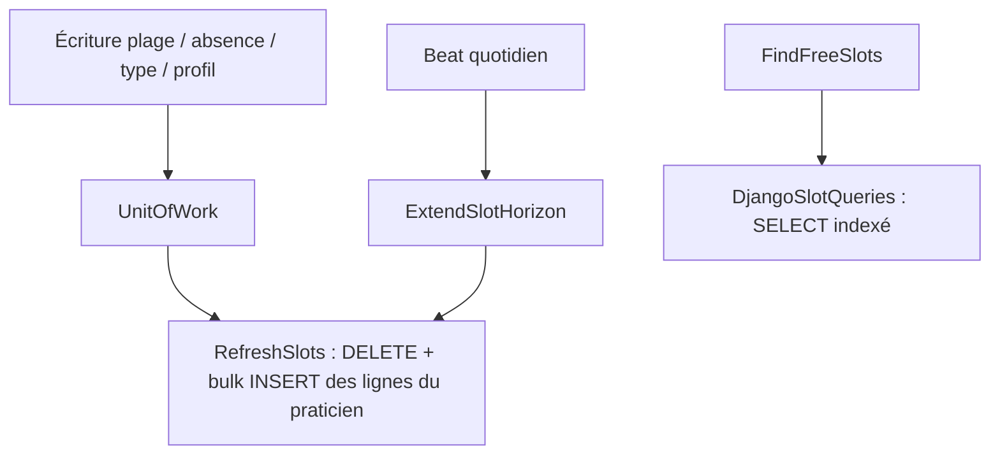

# Instruction: Table `slot` PostgreSQL, rafraîchissement transactionnel, horizon quotidien
## Architecture projection
> Tree of the final files. ✅ create · ✏️ modify · ❌ delete

```txt
.
├── src/drlibre/scheduling/
│   ├── application/
│   │   ├── ports/inbound.py                     ✏️  ExtendSlotHorizon
│   │   └── use_cases/extend_slot_horizon.py     ✅  rebuilds every clinician, drops days before today
│   └── infrastructure/
│       ├── django/models.py                     ✏️  SlotModel(clinician, appointment_type, start, end) + two composite indexes
│       ├── django/migrations/0002_slot.py       ✅
│       ├── slot_store.py                        ✅  DjangoSlotStore: replace one clinician's rows in bulk
│       └── slot_queries.py                      ✅  DjangoSlotQueries: one indexed SQL read, start ≥ max(now, from), end ≤ to, clinician in active set, distinct start
├── src/drlibre/organisation/
│   ├── application/ports/outbound.py            ✏️  SlotRefresh port
│   ├── application/use_cases/{save_appointment_type,attach_clinician_profile,edit_clinician_profile,delete_clinician_profile}.py ✏️  call SlotRefresh in their unit of work
│   └── infrastructure/slot_refresh.py           ✅  SchedulingSlotRefresh over scheduling RefreshSlots
├── src/drlibre/interfaces/jobs/tasks.py         ✏️  drlibre.extend_slot_horizon task
├── config/celery.py                             ✏️  daily beat entry
├── src/drlibre/bootstrap/container.py           ✏️
└── tests/
    ├── contracts/test_slot_store.py             ✅  fake vs PostgreSQL, same rows read back by SlotQueries
    ├── integration/test_slot_refresh_postgres.py ✅  write + refresh rolled back together; DST week on real rows
    ├── use_cases/scheduling/test_horizon.py     ✅  horizon advances one day without intervention
    └── fakes/organisation.py                    ✏️  InMemorySlotRefresh records refreshed clinicians
```

## User Journey


## Tasks to do
### `1)` Slot table adapters
> The store is written only by `RefreshSlots`; the query never computes.

1. Model, indexes, migration; `makemigrations --check` clean.
2. `DjangoSlotStore` replaces a clinician's rows atomically within the ambient transaction.
3. `DjangoSlotQueries` returns unique sorted starts; past and inactive filtered in SQL.

### `2)` Refresh triggers outside scheduling
> Organisation writes that change duration, buffer or department refresh the affected clinicians.

1. `SlotRefresh` outbound port in organisation, adapter calling the scheduling inbound port; no direct import of scheduling from organisation's core.
2. Type save refreshes every clinician of its department; profile attach/edit/delete refreshes that clinician.

### `3)` Horizon job
> The 90-day horizon moves forward daily with no human action.

1. Celery task calling `ExtendSlotHorizon` through `container()`; beat entry daily at 00:15.
2. Correctness never depends on the job: past filtered at read time.

## Test acceptance criteria
| Task | Acceptance criteria |
| --- | --- |
| 1 | Contract: the fake and PostgreSQL return identical slots for the same refresh |
| 1 | Integration: an audit failure rolls back the rule and its slot rows together |
| 2 | Editing a type's duration changes the slots of its department's clinicians in the same response |
| 3 | With the clock moved one day, the last horizon day is present without any write |
