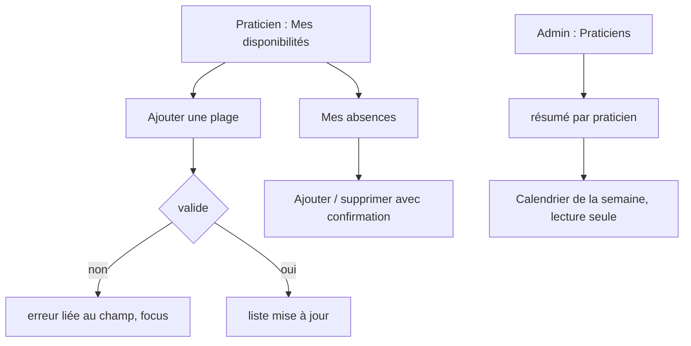

# Instruction: `GET /slots`, écrans praticien, résumé et calendrier admin
## Architecture projection
> Tree of the final files. ✅ create · ✏️ modify · ❌ delete

```txt
.
├── src/drlibre/interfaces/
│   ├── api/slots.py                             ✅  GET /slots?type=&clinician=&start=&end= ; session required → unauthenticated
│   ├── api/__init__.py                          ✏️  mounts the slots router
│   └── web/
│       ├── views/workspace_availability.py      ✅  clinician: list, create, edit, confirm delete rules; list, create, confirm delete time off
│       ├── views/console_clinicians.py          ✏️  summary column; read-only week calendar view
│       ├── presenters/availability.py           ✅  rule and time-off list/form ViewModels, weekly summary text, week grid ViewModel
│       ├── templates/workspace/{availability,time_off}.html ✅
│       ├── templates/console/clinician_week.html ✅  read-only grid, named time zone, week navigation
│       ├── templates/_nav.html                  ✏️  clinician links
│       └── urls.py                              ✏️
└── tests/
    ├── api/test_slots_endpoint.py               ✅  integration: unauthenticated 401, 32-day 400, created rule then time off reflected
    ├── api/test_workspace_availability.py       ✅  integration: own records only, admin calendar read-only
    ├── presenters/test_availability_presenters.py ✅
    └── features/scheduling/
        ├── l_admin_voit_le_resume_hebdomadaire_des_disponibilites.feature        ✅
        └── l_admin_consulte_le_calendrier_de_la_semaine_d_un_praticien.feature   ✅
```

## User Journey


## Wireframe
```txt
┌──────────────────────────────────────────────┐
│ (1) Nav espace praticien                      │
├──────────────────────────────────────────────┤
│ (2) Mes plages · Fuseau : Europe/Paris        │
│ ┌──────────┬────────────┬─────┬──────┬─────┐ │
│ │ Jour     │ Horaire    │ Pas │ Salle│ (3) │ │
│ └──────────┴────────────┴─────┴──────┴─────┘ │
│ [ Ajouter une plage ] (4)                     │
├──────────────────────────────────────────────┤
│ (5) Mes absences · Fuseau : Europe/Paris      │
│  début · fin · motif · [Supprimer]            │
│ [ Ajouter une absence ]                       │
└──────────────────────────────────────────────┘
```
1. Nav: today placeholder, availability, time off.
2. Rule list, time zone named; empty state when none.
3. Row actions: edit, delete (confirmation page).
4. Form: weekday, start, end, step, optional room; errors tied to fields.
5. Time-off list and form: start, end, optional reason.

```txt
┌──────────────────────────────────────────────┐
│ (1) Dr X · semaine du … · Fuseau : …          │
│ [‹ Semaine précédente] [Cette semaine] [›] (2)│
├──────┬─────┬─────┬─────┬─────┬─────┬────┬───┤
│ (3)  │ Lun │ Mar │ Mer │ Jeu │ Ven │ Sam│Dim│
│07:00 │     │     │     │     │     │    │   │
│ …    │ ▓ Disponible (4)  ░ Absence (5)       │
│19:00 │     │     │     │     │     │    │   │
└──────┴─────┴─────┴─────┴─────┴─────┴────┴───┘
```
1. Header: clinician, week start, time zone named; no write action.
2. Week navigation through `?week=YYYY-MM-DD`; bad value falls back to this week.
3. Grid 07:00–19:00, 30-minute rows; a table with headers for screen readers, scrolls inside its region at 375 px.
4. Availability cells labelled in text, not colour alone.
5. Time-off cells labelled in text.

## Tasks to do
### `1)` API
> `GET /slots` per §14, existing session cookie.

1. Ninja router with a Pydantic query schema (`extra="forbid"`); no session → `unauthenticated`; errors via the existing handler.
2. Response `{"slots": [{"start", "end"}]}` ISO 8601 with offset.

### `2)` Clinician screens
> Presenters build ViewModels; templates hold no logic.

1. Views behind `require_role(Role.CLINICIAN)`; catch only `invalid_input` and `forbidden` (rule `6-domain-errors`).
2. Local time input and display in the hospital time zone, named on the page.

### `3)` Admin summary and calendar
> Read-only, through `AvailabilityQueries`.

1. Summary column in the clinicians list; week calendar view per clinician.
2. Feature files for the two admin Stories run on fakes.

## Test acceptance criteria
| Task | Acceptance criteria |
| --- | --- |
| 1 | Without session `GET /slots` → 401 `unauthenticated`; 32 days → 400 `invalid_input` |
| 1 | A rule created then a time off recorded change the next `GET /slots` answer |
| 2 | Another clinician's rule id → 403 page; overlapping rule re-renders the form with focus on the field |
| 3 | The calendar page offers no form or write button; summary reflects an edit immediately |
