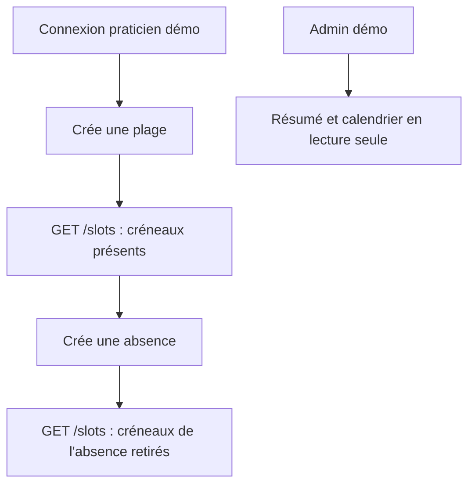

# Instruction: Seed, parcours end-to-end, documentation
## Architecture projection
> Tree of the final files. ✅ create · ✏️ modify · ❌ delete

```txt
.
├── scripts/seed.py                              ✏️  demo clinicians get weekly rules through the use cases, idempotent
├── tests/integration/test_seed.py               ✏️  re-run adds no rule, slots exist for the demo clinician
├── tests/e2e/test_clinician_availability_journey.py ✅  demo clinician creates a rule then a time off; GET /slots reflects both; axe at 375 and 1440 px on the four new pages
├── aidd_docs/memory/codebase-map.md             ✏️  scheduling context, slot table, new screens
├── aidd_docs/memory/architecture.md             ✏️  slot refresh triggers, read-time past filter, NoAppointmentsYet in scheduling
├── aidd_docs/backlog/open-questions.md          ✏️  E2 questions answered with the plan's decisions
└── README.md                                    ✏️  demo clinician availability
```

## User Journey


## Tasks to do
### `1)` Seed and journey
> Success Evidence of the Epic, shown on the real stack.

1. Seed rules for every demo clinician through `SaveAvailabilityRule`, skipping existing ones.
2. Playwright journey on `localhost:8000` with vendored axe-core, 375 and 1440 px.

### `2)` Docs
> Memory reflects what exists.

1. Update the memory files and README; answer the E2 open questions.
2. Run every gate of `coding-assertions.md`.

## Test acceptance criteria
| Task | Acceptance criteria |
| --- | --- |
| 1 | `uv run pytest -m e2e` green, no axe violation at 375 and 1440 px |
| 1 | Seed run twice leaves the same rule count |
| 2 | `uv run pre-commit run --all-files` and `uv run pytest` green |
